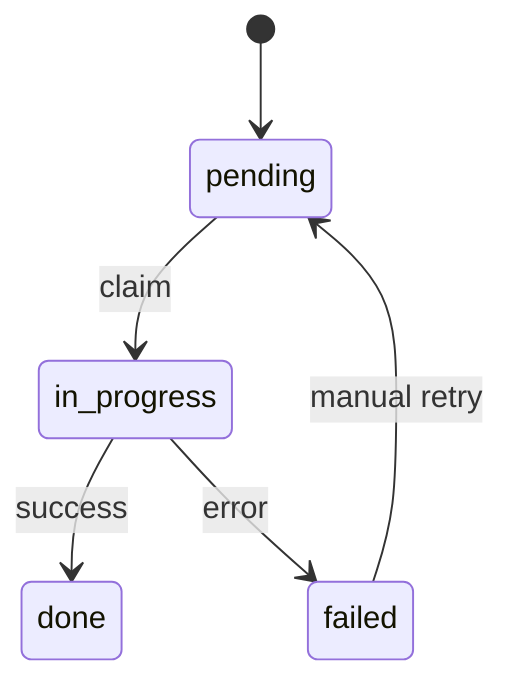

I run a small private toolkit—[Tools Center](https://tools.omid.dev)—where a logged-in user pastes a URL and the host pulls the file, optionally sends it to their own cloud storage, and keeps a history. The interesting engineering problem is not the form. It is **how to finish a multi-minute download without Redis, a worker pool, or a second process supervisor**.

This series is about that class of system: frameworkless PHP on one host. The [source is public](https://github.com/omidfarhang/tools.omid.dev), but the repository has no license file, so I am linking it as a worked example rather than presenting it as an open-source product. The hosted app remains private.

## The constraint

A download can take longer than a reasonable HTTP request. Under Apache, the tempting solution is to start a CLI process with `exec()`, return a redirect, and let the child finish. In practice, that child can die with the request. The browser sees a success message while the job never moves.

For a busy service, the right answer is usually a real queue and supervised workers. For a private box with a handful of users, that stack adds more operations than the feature warrants. This system needs three smaller guarantees:

1. The database records work before the response ends.
2. Processing continues after the browser receives its redirect.
3. A later page request or status poll can retry work left behind.

## Finish the response, then work

The reusable dispatcher registers a shutdown function, disconnects the response, and processes one durable job:

```php
register_shutdown_function(static function () use ($jobId): void {
    ignore_user_abort(true);
    @set_time_limit(0);

    if (function_exists('fastcgi_finish_request')) {
        @fastcgi_finish_request();
    } else {
        while (ob_get_level() > 0) {
            @ob_end_flush();
        }
        @flush();
    }

    try {
        (new DownloadJobProcessor())->process($jobId);
    } catch (\Throwable) {
        // Leave status for a later page/API retry.
    }
});
```

`fastcgi_finish_request()` flushes the response and tells PHP-FPM that the client-facing part is complete. `ignore_user_abort(true)` prevents a closed tab from stopping the remaining PHP work. The broad catch is intentional: the database state is the recovery mechanism, so the shutdown handler must not turn one failure into another response error.

The full implementation is in [`DownloadJobDispatcher.php`](https://github.com/omidfarhang/tools.omid.dev/blob/master/src/DownloadJobDispatcher.php).

## The form uses the same request

The download form takes a more direct route. It creates all job rows, closes the session, sends a `302` with `Connection: close`, calls `fastcgi_finish_request()`, and then processes the jobs before exiting:

```php
session_write_close();

header('Location: ' . $dest);
header('Connection: close');
header('Content-Length: 0');
http_response_code(302);
// Flush output buffers.
if (function_exists('fastcgi_finish_request')) {
    @fastcgi_finish_request();
}

ignore_user_abort(true);
@set_time_limit(0);
$processor = new DownloadJobProcessor();
foreach ($jobIds as $jobId) {
    try {
        $processor->process($jobId);
    } catch (\Throwable) {
        // Job stays pending/in_progress for Home/API retry.
    }
}
```

Closing the session before long work matters. PHP sessions are normally locked; leaving the lock open would make another tab wait behind a download that could take minutes.

The complete request path is in [`public/index.php`](https://github.com/omidfarhang/tools.omid.dev/blob/master/public/index.php).

## The rows are the queue

There is no broker. A row in `download_jobs` is the queue entry.



One URL can create several rows—one for disk and one for each selected cloud provider. That keeps outcomes independent: saving locally can succeed even if Dropbox fails. The processor atomically claims a pending row, resolves the source, enforces quota, performs the download, and starts cloud delivery where necessary. Terminal states short-circuit repeated requests.

This is less capable than a broker, but it gives the important property: submitting the form and executing the work are separate state transitions.

## Retry without a daemon

If PHP stops before processing a pending row, later traffic picks it up:

```php
public static function dispatchPending(int $limit = 5): void
{
    $ids = (new DownloadJobRepository())->pendingIds($limit);
    foreach ($ids as $id) {
        self::dispatch($id);
    }
}
```

The home page schedules a few pending jobs after its response. The status-polling endpoint does the same with a small bound. Manual retry dispatches one specific row. There is also a [`process_download_job.php`](https://github.com/omidfarhang/tools.omid.dev/blob/master/scripts/process_download_job.php) CLI wrapper for operations, but the normal application path does not depend on spawning it.

This is recovery on useful traffic, not a guaranteed scheduler. A quiet host does not process a stranded job until someone visits or an operator runs the CLI script.

## Where this stops fitting

| Concern | Post-response PHP | Dedicated queue |
| --- | --- | --- |
| Operations | Almost none | Broker and worker supervision |
| Parallelism | Bound by PHP workers | Explicitly tunable |
| Recovery | Next request or manual CLI | Continuously running consumer |
| Multiple hosts | Awkward | Normal |

This design fits one host, low concurrency, and jobs measured in minutes rather than a growing backlog. Move to a real worker when downloads consume interactive capacity, jobs must start without web traffic, retries need backoff and dead-letter handling, or the service grows beyond one machine.

Until then, durable rows plus “finish the response, then work” are an honest match for a private box.

## Next in the series

The work that made this pattern necessary is [operating yt-dlp on a self-hosted box](/2026/10/16/operating-yt-dlp-on-a-self-hosted-box/). The same service protects accounts with [WebAuthn and TOTP](/2026/10/18/webauthn-and-totp-in-frameworkless-php/) and sends files through [per-user cloud OAuth](/2026/10/20/per-user-cloud-oauth-on-one-host/).
