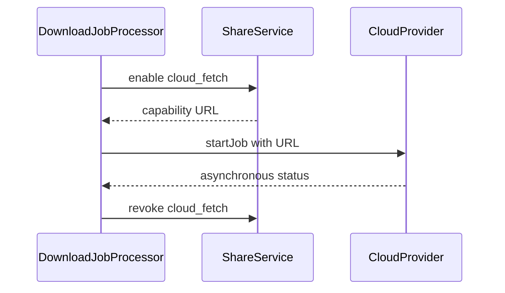

The easy way to add Dropbox to a personal script is one refresh token in `.env`. That works until a second person should send a file to **their** account rather than yours.

[Tools Center](https://tools.omid.dev) treats cloud storage as optional egress from a private host. The site owns OAuth **application** credentials; each user connects their own Dropbox or Google Drive account; the CLI never receives a shared cloud refresh token. The [public repository](https://github.com/omidfarhang/tools.omid.dev) shows the implementation.

This is the last part of [Frameworkless PHP on One Host](/2026/10/14/background-jobs-without-a-queue-php-apache/).

## Separate application identity from user authority

There are two different kinds of OAuth material:

- The administrator configures the provider’s client id and client secret for the site.
- Each user completes authorization and stores tokens tied to their account.

The first says “this request comes from Tools Center.” The second says “this particular user allowed access to their Dropbox or Drive.” A global `DROPBOX_REFRESH_TOKEN` would collapse those identities and make every user act as the operator.

The product boundary is equally important: this is not a Dropbox clone. Cloud is an optional destination. Local files, when selected, remain under the host’s normal ownership and quota model.

## A small provider registry

Dropbox and Google Drive implement one `CloudProvider` contract and register in a plain PHP registry:

```php
public static function default(): self
{
    return new self([
        new DropboxProvider(),
        new GoogleDriveProvider(),
    ]);
}

public function get(string $id): ?CloudProvider
{
    return $this->providers[$id] ?? null;
}
```

The registry can also return the first provider that is both configured for the site and connected for the current user. That default is useful for legacy CLI calls, but the web UI sends an explicit provider id. “First connected” should be a compatibility rule, not an invisible choice in a multi-provider interface.

See [`CloudRegistry.php`](https://github.com/omidfarhang/tools.omid.dev/blob/master/src/Cloud/CloudRegistry.php).

## One URL creates independent destination jobs

When a user selects disk, Dropbox, and Drive, the form creates three `download_jobs` rows. Cloud rows carry their provider, folder, conflict policy, and delete-after preference.

That is intentionally not one giant “download everywhere” transaction:

- Disk can succeed while one provider fails.
- Each provider can report its own asynchronous state.
- Retry does not duplicate successful destinations.
- The UI can describe each outcome honestly.

The [series anchor](/2026/10/14/background-jobs-without-a-queue-php-apache/) covers how those rows run after the redirect. For media sources, [yt-dlp operations](/2026/10/16/operating-yt-dlp-on-a-self-hosted-box/) happen before cloud delivery.

## When a provider needs a URL

A cloud provider may accept a remote URL instead of a local filesystem path. To send an existing local file, the service creates a capability URL with the special purpose `cloud_fetch`:

```php
public function sendLocalFile(
    array $user,
    array $file,
    string $folder,
    string $conflict,
    bool $deleteAfter,
    ?string $providerId = null,
): array {
    $shares = new ShareService();
    $token = $shares->enable(
        (int) $file['id'],
        (int) $user['id'],
        purpose: 'cloud_fetch'
    );
    $fetchUrl = ShareService::publicUrl($token);

    return $this->startForUser(
        $user,
        $fetchUrl,
        (string) $file['original_name'],
        $folder,
        $conflict,
        $deleteAfter,
        (int) $file['id'],
        $providerId,
    );
}
```



[`CloudJobFinalizer.php`](https://github.com/omidfarhang/tools.omid.dev/blob/master/src/Cloud/CloudJobFinalizer.php) revokes cloud-fetch shares when the provider finishes, then optionally deletes the local copy. User-created public shares use a separate `user` purpose and are not revoked by cloud finalization.

The trade-off is direct: for a limited window, anyone holding the capability URL can fetch the file without a session. A private host can accept that when tokens are unguessable, purpose is explicit, and completion revokes the URL. A public multi-tenant service should demand shorter expiries, stronger auditing, or direct provider uploads.

See [`CloudSendService.php`](https://github.com/omidfarhang/tools.omid.dev/blob/master/src/Cloud/CloudSendService.php) and [`ShareService.php`](https://github.com/omidfarhang/tools.omid.dev/blob/master/src/ShareService.php).

## The CLI acts as one real user

The [authentication post](/2026/10/18/webauthn-and-totp-in-frameworkless-php/) described the `X-CLI-Token` exception. Once verified, that token maps to `APP_CLI_USERNAME`. Cloud work uses the connected provider tokens for that user.

This gives automation an understandable owner:

- Disconnect that user’s Dropbox and the CLI loses Dropbox access.
- Disable the user and the CLI identity stops working.
- Rotate the CLI token without changing OAuth grants.
- Reconnect OAuth without distributing a new refresh token to scripts.

There is still a broad secret—the CLI token—but it is an application credential with a narrow endpoint surface, not a cloud provider credential copied into multiple environments.

## Provider state belongs to the user

`CloudSendService::startForUser()` resolves a provider against the supplied user before starting work. The provider decides whether site credentials exist and whether that user has connected an account:

```php
$provider = $this->resolveProvider($user, $providerId);
if ($provider === null) {
    return [
        'success' => false,
        'message' => 'Connect a cloud account first.',
        'error' => 'not_connected',
    ];
}

return $provider->startJob(
    $user,
    $url,
    $filename,
    $folder,
    $conflict,
    $deleteAfter,
    $fileId,
);
```

Passing the user all the way to the provider is less magical than a process-wide client singleton. That is useful here: token ownership stays visible in method signatures.

## When this stops fitting

| Concern | Private one-host model | Multi-tenant service |
| --- | --- | --- |
| App credentials | One admin-managed pair | Platform or tenant isolation |
| Refresh tokens | Per-user rows in one SQLite DB | Isolated encrypted stores and audit |
| CLI | One mapped user | Scoped service identities |
| Provider fetch | Temporary capability URL | Short TTL, direct upload, or signed gateway |

For a small private service, per-user OAuth and temporary fetch capabilities are proportional controls. For a customer-facing SaaS, the same mechanism would need stricter tenancy, token storage, revocation guarantees, and audit trails.

## The whole series

1. [Background Jobs Without a Queue](/2026/10/14/background-jobs-without-a-queue-php-apache/)—post-response work on Apache.
2. [Operating yt-dlp on a Self-Hosted Box](/2026/10/16/operating-yt-dlp-on-a-self-hosted-box/)—Deno, cookies, and path confinement.
3. [WebAuthn and TOTP Without a Framework](/2026/10/18/webauthn-and-totp-in-frameworkless-php/)—MFA and an explicit automation exception.
4. This post—per-user cloud authority without a shared refresh token.

None of these require a framework. They do require clear ownership of jobs, secrets, URLs, and failure states—which is most of the engineering on a one-host PHP service.
